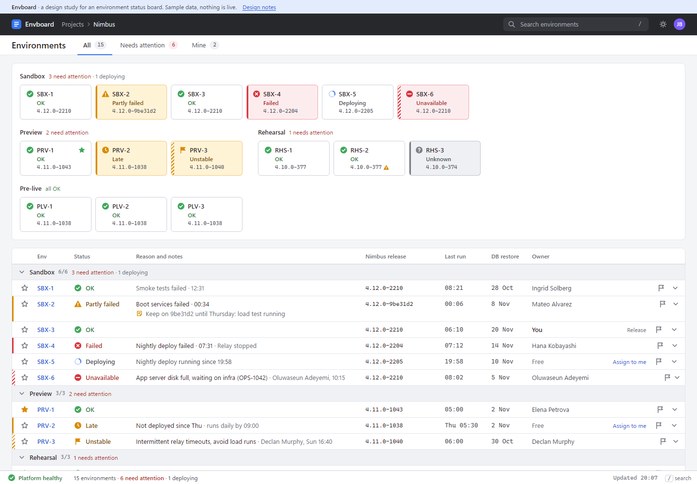
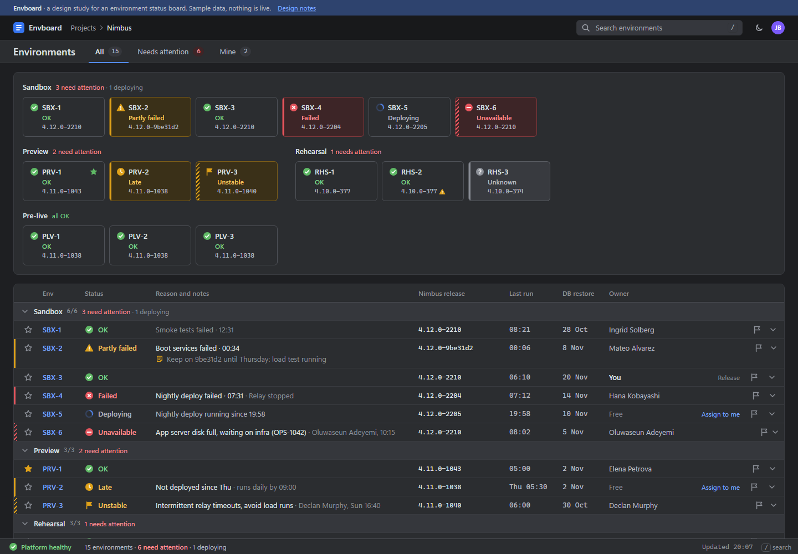

# Envboard

A design study for an **environment status board**: one screen that answers "is my environment safe to use?" first, and "what is deployed where?" second.

**[Open the live demo](https://nielk74.github.io/envboard/)** · it is a single static page with made-up sample data, nothing is live.





## What it shows

- **A board that summarises everything.** Every environment sits under its stage with one line of summary, for example "3 need attention · 1 deploying". Past the board, a slim strip of the same chips stays pinned under the header.
- **A grouped table for the detail.** Stage rows fold. Each environment is one line: status, reason, release, last run, DB restore, owner. Open a row for job times, the manual flag, a standing note and ownership.
- **Green means ready.** A healthy environment gets one calm tick. Problems add a bar, a word and a stronger colour. Deploying is blue and is not counted as a problem.
- **Honest versions.** The release is aligned monospace. A second component's version appears only when it differs, with a small warning triangle.
- **Late deploys are visible.** If a nightly or weekly deploy did not run, the environment turns amber.
- **Clear ownership.** "Assign to me" only appears on free environments. Taking one from someone asks first and can end at a set time.
- **Flags need a reason.** Marking an environment unstable or unavailable requires a reason. Hatched stripes mean "set by a person" and appear nowhere else.

## The frame

The chrome is borrowed from JetBrains IDEs and TeamCity-style build tools: a dark application bar with breadcrumb and global search, a page title with underlined filter tabs, collapsible group rows in the table, filled status icons, a compact 13 px type scale, and a status bar at the bottom with platform health and live counts. Light and dark themes follow the system and can be switched from the bar.

## Keyboard

| Key | Action |
| --- | --- |
| `/` | Focus search |
| `Esc` | Clear search, close a popover or the notes drawer |

## Running it

There is nothing to build. Open `index.html` in a browser, or serve the folder:

```sh
python -m http.server 8000
```

## Notes

- All names, versions, tickets and people in the sample data are invented.
- No external requests: no web fonts, no scripts, no analytics. Fonts fall back through Inter, JetBrains Sans and the system UI font.
- Inspired by the look of JetBrains products and TeamCity. Not affiliated with or endorsed by JetBrains.

## License

[MIT](LICENSE)
